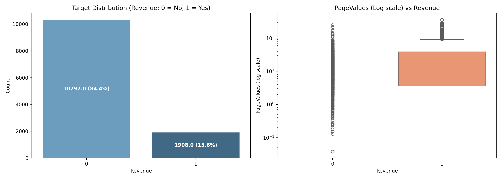
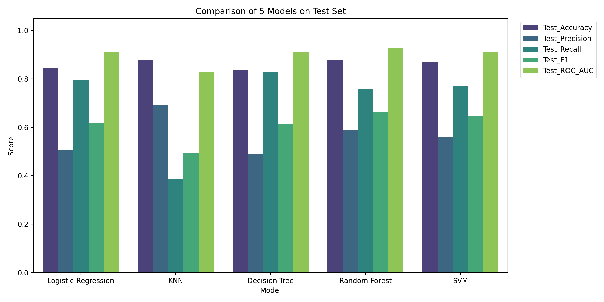
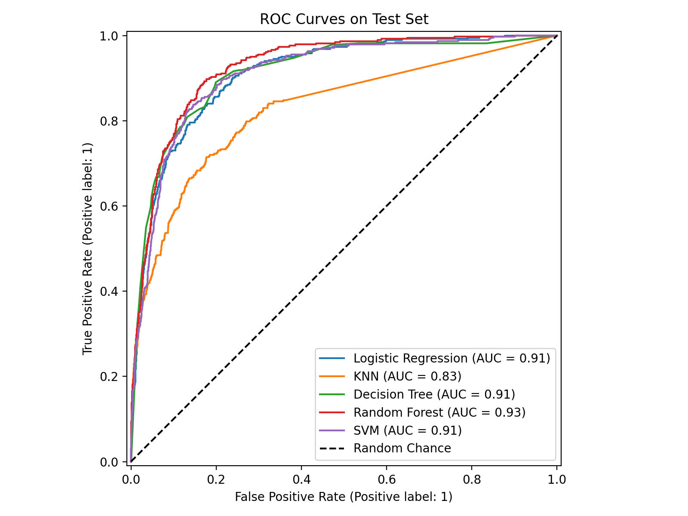
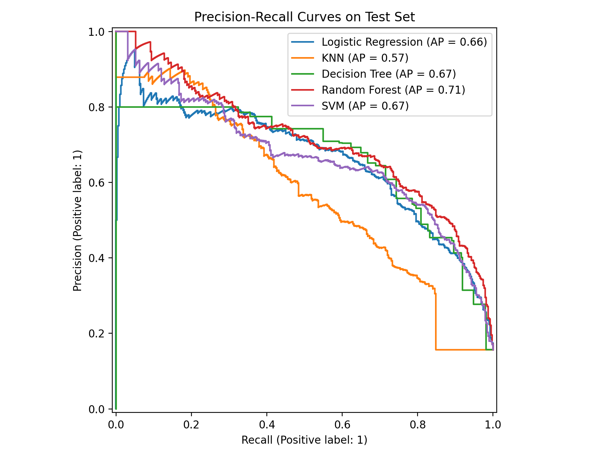
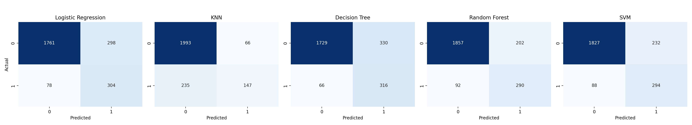
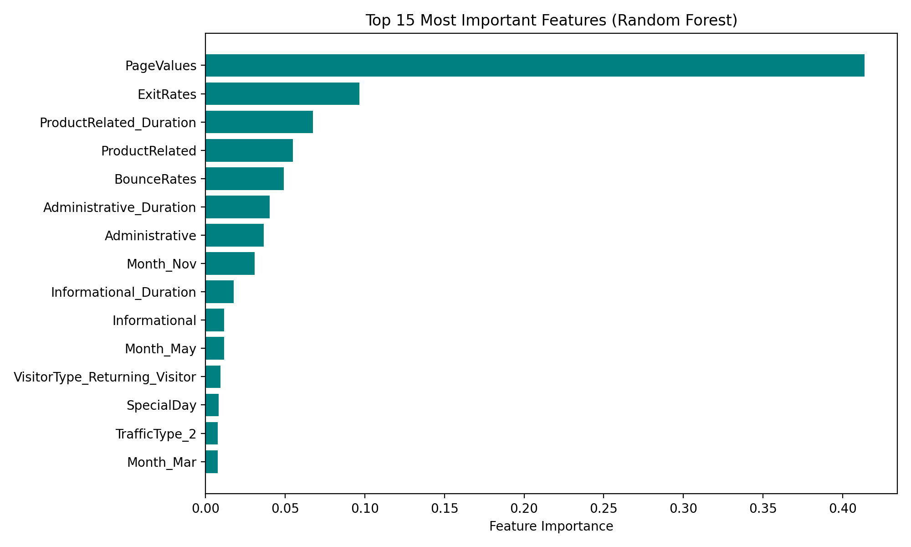

<!-- Slide 1: Title Slide -->
<!-- _header: "" -->
<!-- _footer: "" -->

Machine Learning Final Project

# Online Purchase Intention Prediction
### A Comparative Benchmark of 5 Supervised Classifiers

  

    How clickstream behavior, Google Analytics indicators, and class balancing strategies predict customer checkouts in e-commerce.
  

  

    
Authors

    
Hoàng Văn Đô (24107948)

    
Phan Hoàng Nhật (24100092)

  

  

    
Faculty

    
Faculty of Computer Science

    
Phenikaa University, Hanoi

  

  

    
Dataset & Code

    
UCI Shoppers Intention (12.3k sessions)

    
Scikit-Learn Python Pipeline

  

---

<!-- Slide 2: The Problem Context -->
## The E-Commerce Conversion Dilemma

  

    

      
~15.5%

      
Actual purchasing sessions in dataset (84.5% leave without buying)

    

    

      In online retail, millions browse but few buy. Intervening with discounts or live chat on every user causes huge profit leakage. Intervening on nobody loses high-value customers.
    

    

      <strong style="color: #0369a1; font-size: 14px;">Goal:</strong>
      
Predict purchase intention in real-time so merchants can intervene only when it matters.

    

  

  

    

      
1

      

        <strong>The Accuracy Paradox</strong>
        
A naive model predicting "Nobody Buys" gets 84.5% accuracy but zero business value. We must optimize F1, Recall & PR-AUC.

      

    

    

      
2

      

        <strong>High Dimensional Sparsity</strong>
        
Combining numeric analytics with categorical sources (browser, OS, months) expands feature space to 68 dimensions after one-hot encoding.

      

    

    

      
3

      

        <strong>Five Fundamental Models Tested</strong>
        
Logistic Regression, KNN, Decision Tree, Random Forest, and SVM evaluated side-by-side.

      

    

  

---

<!-- Slide 3: Dataset Anatomy -->
## UCI Dataset & Feature Architecture

  

    
    

      Left: 84.5% vs 15.5% Class Imbalance | Right: Log-scale distribution of PageValues
    

  

  

    <h3 style="color: #0f172a; margin-top: 0;">12,205 Clean Unique Sessions</h3>
    

      
<strong>10 Numerical Behavioral Features:</strong> 
      • Page counts & browsing durations: <code>Administrative</code>, <code>Informational</code>, <code>ProductRelated</code>. 
      • Web analytics: <code>BounceRates</code>, <code>ExitRates</code>, <code>PageValues</code>, <code>SpecialDay</code>.

      
<strong>7 Categorical Session Contexts:</strong> 
      • User context: <code>VisitorType</code>, <code>OperatingSystems</code>, <code>Browser</code>, <code>Region</code>. 
      • Temporal cues: <code>Month</code>, <code>Weekend</code>, <code>TrafficType</code>.

    

    

      
Key Domain Finding:

      
PageValues is non-zero almost exclusively for users who complete checkout.

    

  

---

<!-- Slide 4: End-to-End Preprocessing Pipeline -->
## Leakage-Free Preprocessing Pipeline

  

    

      
A

      

        <strong>Data Cleansing</strong>
        
Removed 125 exact duplicate sessions. Zero missing values detected across all 18 columns.

      

    

    

      
B

      

        <strong>Stratified 80/20 Holdout Split</strong>
        
9,764 training sessions vs 2,441 test sessions. Preserved exact 15.5% positive ratio in both partitions.

      

    

    

      
C

      

        <strong>ColumnTransformer Integration</strong>
        
Numerical scaled via <code>StandardScaler</code>; Categorical transformed via <code>OneHotEncoder(handle_unknown='ignore')</code>.

      

    

  

  

    

      
D

      

        <strong>Class Imbalance Compensation</strong>
        
Employed inverse class frequency penalties inside loss functions: $w_j = \frac{N}{2 \times N_j}$. Prevents models from ignoring the rare positive class.

      

    

    

      
E

      

        <strong>Stratified 5-Fold Cross Validation</strong>
        
All hyperparameter stability tested with 5-fold CV before evaluating against holdout test data.

      

    

  

---

<!-- Slide 5: Benchmark Results Table -->
## Benchmark Results on Holdout Test Set

<table>
  <thead>
    <tr>
      <th>Model</th>
      <th>Accuracy</th>
      <th>Precision</th>
      <th>Recall</th>
      <th>F1-Score</th>
      <th>ROC-AUC</th>
      <th>PR-AUC</th>
    </tr>
  </thead>
  <tbody>
    <tr>
      <td><strong>Logistic Regression</strong></td>
      <td>84.60%</td>
      <td>0.5050</td>
      <td>0.7958</td>
      <td>0.6179</td>
      <td>0.9097</td>
      <td>0.6627</td>
    </tr>
    <tr>
      <td><strong>K-Nearest Neighbors (k=7)</strong></td>
      <td>87.67%</td>
      <td><strong>0.6901</strong></td>
      <td>0.3848</td>
      <td>0.4941</td>
      <td>0.8270</td>
      <td>0.5717</td>
    </tr>
    <tr>
      <td><strong>Decision Tree (CART, d=6)</strong></td>
      <td>83.78%</td>
      <td>0.4892</td>
      <td><strong>0.8272</strong></td>
      <td>0.6148</td>
      <td>0.9119</td>
      <td>0.6673</td>
    </tr>
    <tr class="highlight-row">
      <td><strong>★ Random Forest (150 trees)</strong></td>
      <td><strong>87.96%</strong></td>
      <td>0.5894</td>
      <td>0.7592</td>
      <td><strong>0.6636</strong></td>
      <td><strong>0.9258</strong></td>
      <td><strong>0.7096</strong></td>
    </tr>
    <tr>
      <td><strong>SVM (RBF Kernel)</strong></td>
      <td>86.89%</td>
      <td>0.5589</td>
      <td>0.7696</td>
      <td>0.6476</td>
      <td>0.9095</td>
      <td>0.6695</td>
    </tr>
  </tbody>
</table>

  <strong>Key Insight:</strong> Random Forest wins across F1-Score (0.6636), ROC-AUC (0.9258), and PR-AUC (0.7096).

---

<!-- Slide 6: Visual Comparison & Metrics -->
## Multi-Metric Performance Overview

  

    
  

  

    

      
✓

      

        <strong>Random Forest: The Balanced Leader</strong>
        
Strikes the ideal sweet spot: high recall (75.9%) without collapsing precision (58.9%).

      

    

    

      
✗

      

        <strong>KNN: The Dimensionality Victim</strong>
        
Highest precision (69.0%) but catastrophic recall (38.5%). Misses over 61% of buyers because Euclidean distance breaks down in 68-dimension sparse space.

      

    

    

      
ℹ

      

        <strong>Decision Tree: Maximum Sensitivity</strong>
        
Highest raw recall (82.7%) but lowest precision (48.9%). High false alarm rate.

      

    

  

---

<!-- Slide 7: ROC and PR Discrimination Curves -->
## ROC & Precision-Recall Trajectories

  

    
    

      <strong>ROC Curves:</strong> Random Forest leads with AUC = 0.93, followed by Decision Tree and SVM.
    

  

  

    
    

      <strong>PR Curves (Sensitive to Imbalance):</strong> Random Forest maintains superior precision across high recall thresholds (AP = 0.71).
    

  

---

<!-- Slide 8: Confusion Matrix Breakdown -->
## Operational Trade-Offs in Confusion Matrices

  

  

    <strong style="color: #0f172a;">Decision Tree & Logistic:</strong> High False Positives (~250-310). Good when missing a customer is catastrophic, but sends too many unnecessary discounts.
  

  

    <strong style="color: #166534;">Random Forest:</strong> Capped False Positives at 202 while capturing 290 out of 382 true buyers. Lowest overall commercial cost.
  

---

<!-- Slide 9: Feature Importance & Explainability -->
## What Actually Drives the Purchase?

  

    
  

  

    <h3 style="color: #0f172a; margin-top: 0;">Top Predictors Decoded</h3>
    

      
1

      

        <strong>PageValues (Dominant >38%)</strong>
        
Users visiting pages with historical monetary association exhibit overwhelming conversion probability.

      

    

    

      
2

      

        <strong>ExitRates & BounceRates</strong>
        
Strong negative indicators. High bounce rates signal casual window shoppers.

      

    

    

      
3

      

        <strong>Month of November (Month_Nov)</strong>
        
Highest categorical rank. Direct reflection of Black Friday and holiday promotional rushes.

      

    

  

---

<!-- Slide 10: Conclusion & Recommendations -->
## Conclusion & Business Recommendations

  

    <h3 style="color: #0f172a;">Key Takeaways</h3>
    <ul style="font-size: 15px; color: #475569; line-height: 1.7; padding-left: 20px;">
      <li><strong>Best Model:</strong> Random Forest is decisively superior for tabular e-commerce clickstreams (F1: 0.6636, ROC-AUC: 0.9258).</li>
      <li><strong>Tree Ensembles > Metric Models:</strong> Bagging trees effortlessly absorb non-linear combinations and one-hot sparsity that crippled KNN.</li>
      <li><strong>Class Balancing is Mandatory:</strong> Unweighted models fail to generate actionable business alerts.</li>
    </ul>
  

  

    <h3 style="color: #0369a1;">Next Steps & Extensions</h3>
    

      
Production Deployment:

      

        Deploy Random Forest as a streaming inference microservice (sub-50ms latency) triggered when PageValues > 0.
      

    

    

      
Future Algorithms:

      

        Benchmark XGBoost, LightGBM, and CatBoost with Bayesian Hyperparameter Tuning.
      

    

  

  Thank you! Q & A Session.

